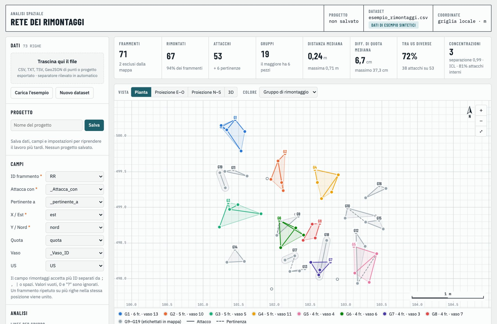
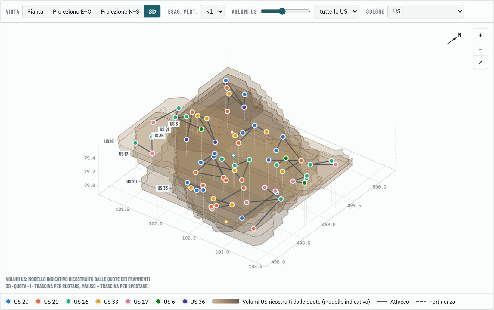
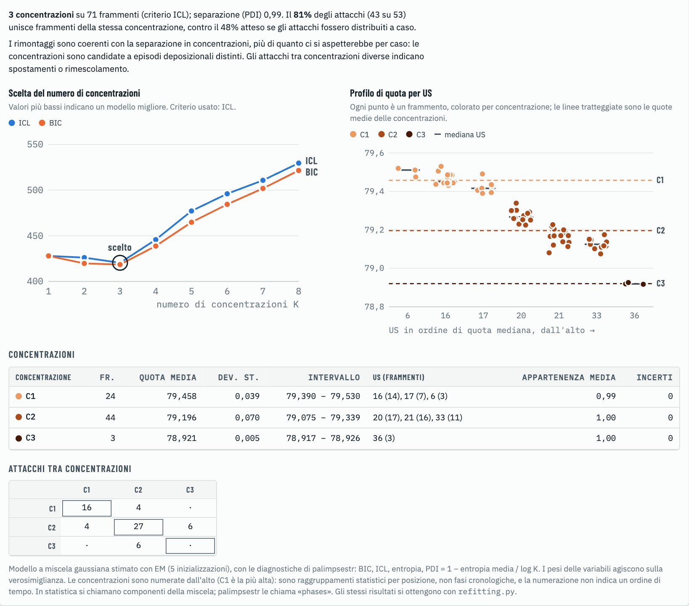
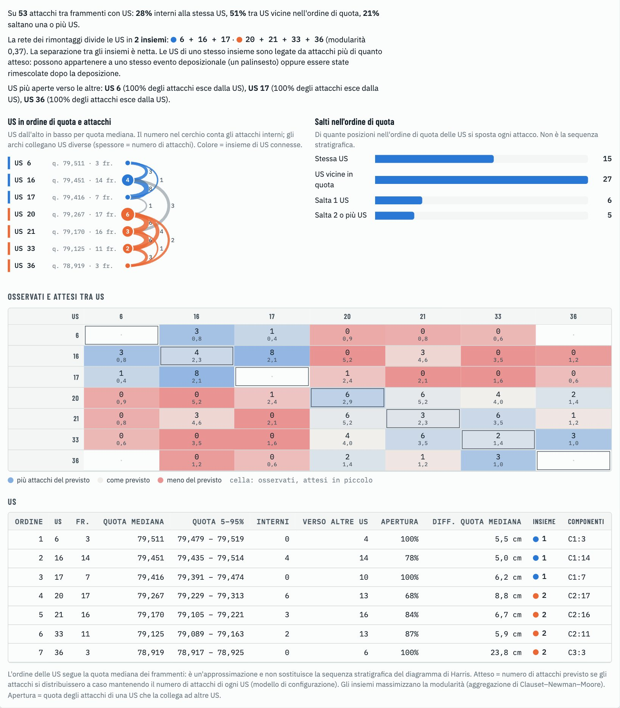
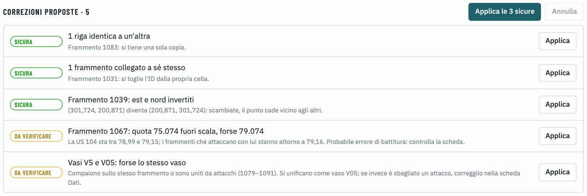
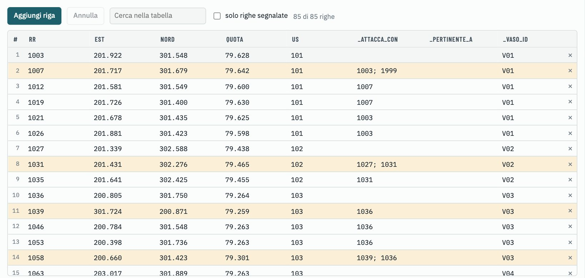

# Rete dei rimontaggi

Uno strumento per studiare i **rimontaggi** (attacchi e pertinenze tra frammenti) come una rete, e usarli per leggere la formazione del deposito archeologico: dove si è rotto un vaso, quanto si sono mossi i pezzi, quali unità stratigrafiche (US) sono legate tra loro e se i raggruppamenti dei frammenti per posizione sono confermati dai rimontaggi.

È un'unica pagina HTML: si apre nel browser, non richiede installazioni né server, e i dati non lasciano il computer.



## Come si usa

**Online:** apri [enzococca.github.io/rete-dei-rimontaggi](https://enzococca.github.io/rete-dei-rimontaggi/). Anche online i dati che carichi restano nel tuo browser e non vengono inviati a nessun server.

**Sul tuo computer:**

1. Scarica il repository (pulsante **Code → Download ZIP**) oppure solo il file [`index.html`](index.html).
2. Apri `index.html` con un doppio clic in un browser recente (Chrome, Firefox, Safari, Edge).
3. Lo strumento parte con un esempio sintetico già caricato. Per usare i tuoi dati, trascina un file nel riquadro **Dati** oppure crea una tabella da zero con **Nuovo dataset**.

Non serve installare R, Python o un GIS. La connessione a internet serve solo per scaricare i caratteri tipografici: senza rete lo strumento funziona lo stesso.

## Formato dei dati

Lo strumento legge **CSV** (anche `.txt` e `.tsv`) e **GeoJSON di punti**. Una riga, o un punto, per frammento.

```
RR,est,nord,quota,US,Attacca_con,pertinente_a,Vaso_ID
1003,201.922,301.548,79.628,101,,,V01
1007,201.717,301.679,79.642,101,1003,,V01
```

| Campo | Obbligatorio | Note |
|---|---|---|
| ID del frammento | sì | Univoco |
| Attacca con | sì | ID dei frammenti che combaciano, separati da `;` o spazio. Vuoto, `0` o `?` = nessun attacco |
| Est, Nord | sì | **In metri** (griglia di scavo o sistema proiettato), non in gradi |
| Quota | no | Serve per le viste laterali, il 3D e le concentrazioni |
| US | no | Serve per la matrice tra US e l'analisi del palinsesto |
| Pertinente a | no | Frammenti dello stesso vaso che non combaciano |
| Vaso | no | Attribuzione al vaso |

- I nomi delle colonne sono liberi: quelli comuni vengono riconosciuti da soli, gli altri si scelgono nel pannello **Campi**.
- Il separatore del CSV (virgola, punto e virgola, tabulazione) viene riconosciuto da solo; i decimali possono avere il punto o la virgola.
- Nel GeoJSON le coordinate (e la quota, se il punto è 3D) vengono dalla geometria; gli attributi diventano colonne. Va bene l'esportazione diretta da QGIS.
- Un legame basta scriverlo in una delle due righe: lo strumento lo rende simmetrico.

Le regole complete sono in [`dati_esempio/LEGGIMI.md`](dati_esempio/LEGGIMI.md).

## Che cosa calcola

**La rete.** Ogni frammento è un nodo, ogni attacco un legame. I **gruppi di rimontaggio** sono i frammenti collegati tra loro, anche indirettamente. Le pertinenze sono tratteggiate e, salvo scelta esplicita, non uniscono i gruppi.

**Viste.** Pianta, proiezioni verticali est-ovest e nord-sud (tutti i punti visti di lato, non una sezione di scavo) e vista 3D con un modello indicativo dei volumi delle US ricavato dalle quote. Nel 3D si può mettere in evidenza una singola US, una concentrazione o un gruppo di rimontaggio: restano in primo piano le US coinvolte e i frammenti scelti. Colori per gruppo, vaso, US, quota o concentrazione.



**Schede dei risultati.**

| Scheda | Contenuto |
|---|---|
| Gruppi | Gruppi di rimontaggio con estensione, differenza di quota e US coinvolte |
| Collegamenti | Ogni attacco con distanza in pianta, differenza di quota e US |
| Matrice US | Numero di attacchi tra ogni coppia di US |
| Distanze | Istogrammi della distanza in pianta e della differenza di quota |
| Concentrazioni | Raggruppamenti statistici dei frammenti per posizione e verifica con i rimontaggi |
| Palinsesto | Attacchi nell'ordine di quota delle US, osservati contro attesi, insiemi di US |
| Controlli | Errori nei dati e correzioni proposte |
| Dati | La tabella, modificabile cella per cella |

**Concentrazioni (cluster).** Una miscela gaussiana stimata con l'algoritmo EM raggruppa i frammenti per posizione e quota; il numero di concentrazioni si sceglie con due punteggi, BIC (*Bayesian Information Criterion*) e ICL (*Integrated Completed Likelihood*). Il BIC somma quanto il modello si scosta dai dati e una penalità per ogni concentrazione in più; l'ICL aggiunge un'altra penalità quando i frammenti stanno a metà tra due concentrazioni, quindi preferisce concentrazioni ben separate. Vince il valore più basso. Sono punteggi di confronto: il numero in sé non ha unità di misura e non si confronta tra dataset diversi, conta solo quale numero di concentrazioni dà il minimo. Un indice di separazione (PDI) dice infine quanto le concentrazioni sono distinte. Le concentrazioni **non sono fasi cronologiche**: sono raggruppamenti statistici, numerati dall'alto (in statistica si chiamano componenti della miscela). I rimontaggi fanno da verifica indipendente: lo strumento confronta la quota di attacchi interni a ciascuna concentrazione con quella attesa se gli attacchi fossero distribuiti a caso. Il metodo segue il pacchetto R [palimpsestr](https://CRAN.R-project.org/package=palimpsestr).



**Palinsesto.** Le US vengono ordinate per quota mediana dei frammenti (un'approssimazione, da confrontare con il matrix di Harris). Lo strumento conta di quante posizioni si sposta ogni attacco, confronta gli attacchi osservati tra US con quelli attesi per caso (modello di configurazione) e cerca gli insiemi di US più legati tra loro (modularità, algoritmo di Clauset, Newman e Moore).



**Controlli e correzioni.** Lo strumento segnala ID duplicati, coordinate anomale, frammenti senza coordinate, attacchi verso frammenti assenti, gruppi con vasi diversi. Dove può, propone una correzione:

- **sicura**, quando l'errore di trascrizione è evidente (righe doppie, frammento collegato a sé stesso, est e nord invertiti);
- **da verificare**, quando è un'ipotesi (una quota con una cifra sbagliata, lo stesso vaso scritto con due codici).

Ogni correzione si applica con un clic, si può annullare e resta registrata nel progetto. Lo strumento propone, l'archeologo decide.



**Modifica dei dati.** Nella scheda **Dati** la tabella si modifica direttamente: si aggiungono ed eliminano righe, si cerca, si annulla. L'analisi si aggiorna quando si esce da una cella.



**Progetti.** Dati, campi e impostazioni si salvano come progetto nel browser e si riprendono più tardi. Con **Esporta** il progetto diventa un file `.progetto.json`, da trascinare di nuovo nel riquadro Dati su un altro computer.

**Esportazioni.** Collegamenti, gruppi e frammenti in GeoJSON (si aprono in QGIS; il sistema di riferimento va assegnato a mano), tabelle CSV di matrice US, controlli, concentrazioni, sintesi per US, osservati e attesi, un CSV pronto per `palimpsestr::fit_sef` e la tabella dei dati modificati.

## Dati di esempio

Nella cartella [`dati_esempio`](dati_esempio) ci sono dataset **sintetici**, costruiti per mostrare configurazioni diverse:

| File | Che cosa mostra |
|---|---|
| `1_deposito_stratificato` | Vasi rotti in posto, ognuno nella sua US: pochi attacchi tra US diverse |
| `2_fossa_che_taglia` | Una fossa taglia due US e ne porta i cocci nel riempimento: pochi salti lunghi, tutti in un punto |
| `3_area_uso_e_scarico` | Frammenti piccoli nell'area d'uso, pezzi grandi in uno scarico a cinque metri: attacchi lunghi in pianta |
| `4_dati_da_correggere` | Il primo dataset con errori messi apposta, per provare il correttore |

I primi tre sono sia in CSV sia in GeoJSON, con dati identici.

## Parole usate

| Parola | Significato qui |
|---|---|
| Attacco | Due frammenti le cui fratture combaciano: erano lo stesso oggetto fino alla stessa rottura (non per forza la stessa deposizione) |
| Pertinenza | Frammenti attribuiti allo stesso vaso senza contatto: un'ipotesi, non un fatto |
| Gruppo di rimontaggio | Frammenti collegati dagli attacchi, anche indirettamente |
| Concentrazione (cluster) | Raggruppamento statistico di frammenti per posizione; non è una fase cronologica |
| Insieme di US | US che la rete degli attacchi tiene legate più del caso |
| Ordine di quota | US ordinate per quota mediana; non è la sequenza stratigrafica |
| Atteso | Valore che si avrebbe se gli attacchi fossero distribuiti a caso |

## Limiti

- I rimontaggi trovati non sono un campione casuale: di solito si cercano prima tra frammenti della stessa US. Conviene dichiarare come si è cercato.
- L'ordine di quota non sostituisce il matrix di Harris: con fosse, tagli e pendenze può essere diverso dalla sequenza.
- Con poche decine di attacchi gli indici servono a osservare e controllare, non a concludere.
- La frammentazione può essere intenzionale: un attacco tra contesti lontani può essere un gesto, non un disturbo.
- Lo strumento conta, misura e confronta con il caso; l'interpretazione si fa sulla documentazione di scavo.

## Riferimenti

- Bailey G. 2007. Time perspectives, palimpsests and the archaeology of time. *Journal of Anthropological Archaeology* 26(2): 198-223. https://doi.org/10.1016/j.jaa.2006.08.002
- Cocca E. 2026. *palimpsestr: Probabilistic Decomposition of Archaeological Palimpsests*. Pacchetto R. https://doi.org/10.32614/CRAN.package.palimpsestr
- Plutniak S. 2021. The strength of parthood ties. Modelling spatial units and fragmented objects with the TSAR method. *Journal of Archaeological Science* 136: 105501. https://doi.org/10.1016/j.jas.2021.105501
- Plutniak S. 2022. Archeofrag: an R package for refitting and spatial analysis in archaeology. *Journal of Open Source Software* 7(75): 4335. https://doi.org/10.21105/joss.04335
- Schiffer M.B. 1987. *Formation Processes of the Archaeological Record*. Albuquerque, University of New Mexico Press.
- Villa P. 1982. Conjoinable pieces and site formation processes. *American Antiquity* 47(2): 276-290. https://doi.org/10.2307/279901

## Autore

Enzo Cocca

## Licenza

Distribuito con licenza [GNU General Public License v3.0](LICENSE): puoi usarlo, modificarlo e ridistribuirlo, a condizione che le versioni modificate che distribuisci restino sotto la stessa licenza e con il codice sorgente disponibile.
